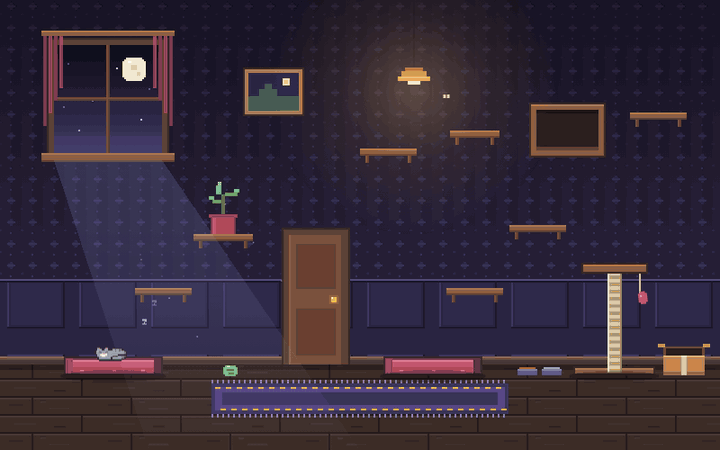

# context-cats

Uma skin escura com fundo animado para o Claude (app desktop e celular): um cômodo de gatos em pixel art.



Os gatos dormem, brincam e correm pelas prateleiras. O número de gatos acompanha o uso do contexto da sessão: um gato a cada 9% usados, até 12. Quando o contexto encolhe, os excedentes vão embora pela porta. A janela e a luz seguem a hora do sistema e o clima.

## Instalar

No prompt de uma sessão de terminal do Claude Code:

```
/plugin install context-cats --marketplace bsfraga/context-cats
```

Responda `y` para adicionar o marketplace e escolha o escopo (o de usuário vale para todas as sessões).

De um shell:

```
claude plugin install context-cats --marketplace bsfraga/context-cats
```

No app desktop, onde `/plugin` não roda: clique em + ao lado da caixa de mensagem, depois Plugins, Add marketplace com `bsfraga/context-cats`, e Add plugin.

## Comandos

- `/gatos` mostra quantos gatos há na cena e o uso de contexto.
- `/gatos <1-12>` fixa a quantidade; `/gatos auto` volta a seguir o contexto.
- `/gatos teste` enche a casa e, oito segundos depois, dispara a saída pela porta.
- `/gatos clima` mostra o céu atual e avisa se a busca do clima falhou.
- `/gatos cidade <nome>` fixa a cidade do clima; `/gatos cidade auto` volta à estimativa pela rede.
- `/gatos ceu <noite|aurora|dia|tarde> <limpo|parcial|nublado|chuva|tempestade|neve|neblina>` força um céu; `/gatos ceu auto` solta.
- `/gatos fuso <minutos>` acerta o fuso em relação a UTC, se a fase do dia aparecer errada.

## Rede e privacidade

A skin consulta o [wttr.in](https://wttr.in) a cada 20 minutos para saber o clima e o horário do nascer e do pôr do sol. Por padrão a consulta não leva nenhuma localização: o serviço estima a cidade pelo IP de quem pede. Com `/gatos cidade <nome>`, o nome da cidade vai na consulta. Nada mais sai da máquina.

## Arquivos

- `hooks/looks.ts`: cores e fontes.
- `hooks/cats.ts`: a cena dos gatos.
- `hooks/sky.ts`: hora e clima.
- `hooks/make-colors.js` e `hooks/make-colors.d.ts`: o gerador de paleta que acompanha a skill plugin-authoring do Claude Code, copiado sem mudanças.

O tema é feito para o modo escuro; o terminal e os editores não desenham temas.

## Licença

MIT.
